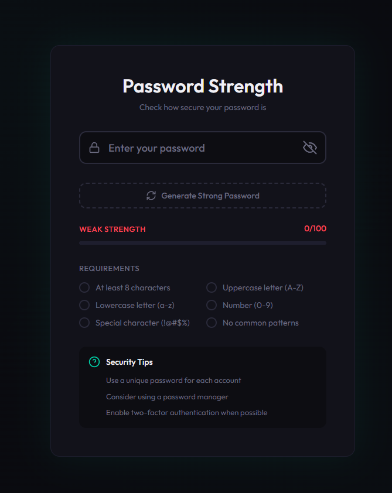

# Password Strength Checker

A modern, real-time password strength analyzer with security recommendations. Built with Next.js.

## Features

- Real-time password strength analysis
- Entropy calculation (bits of randomness)
- Crack time estimation
- Advanced pattern detection:
  - Sequential characters (abc, 123, xyz)
  - Repeated characters (aaa, 111)
  - Keyboard patterns (qwerty, asdf)
  - Leetspeak detection (P@s5w0rd)
  - Common passwords
- Smart improvement suggestions
- Secure password generator
- Copy to clipboard functionality

## Demo



## Getting Started

```bash
npm install
npm run dev
```

Open [http://localhost:3000](http://localhost:3000) in your browser.

## Tech Stack

- Next.js 16
- React
- TypeScript
- CSS Modules (no Tailwind)

## License

MIT